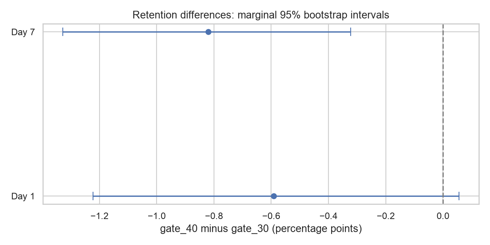
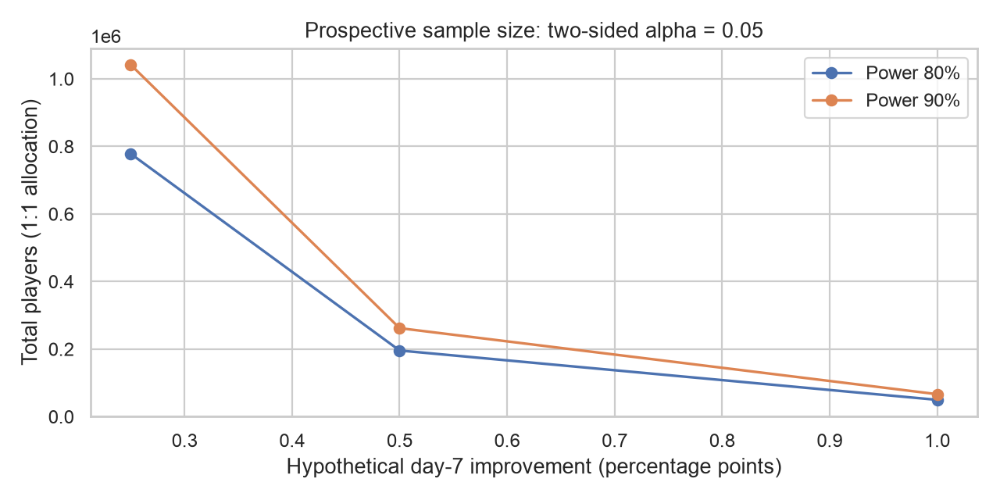

# Cookie Cats A/B 测试：首个关卡门槛与玩家留存

[English](README.md) | [简体中文](README.zh-CN.md)


增强版进一步加入每万名玩家的数量差异换算、Fisher 精确检验、未来实验样本量规划与模拟核对，并将实验有效性核查独立于效果显著性判断。

本项目基于 Cookie Cats 手机游戏数据，对已有 A/B 实验进行复现分析：比较将首个关卡门槛从第 30 关（`gate_30`）延后到第 40 关（`gate_40`）对玩家参与度和留存的影响。项目使用数据源已有的分组，工作范围是离线分析与方法验证。

## 业务问题

延后首个关卡门槛，能否提高玩家参与度和留存率？

## 分析结果

本地数据包含 90,189 位玩家，对照组为 `gate_30`，实验组为 `gate_40`。下表差值统一使用“实验组减对照组”。

| 指标 | gate_30 | gate_40 | 实验组减对照组 | Holm 校正 p 值 |
|---|---:|---:|---:|---:|
| 次日留存率 | 44.8188% | 44.2283% | -0.5905 个百分点 | 0.1004 |
| 第 7 日留存率 | 19.0201% | 18.2000% | -0.8201 个百分点 | 0.0047 |
| 平均游戏局数 | 52.4563 | 51.2988 | -1.1575 局 | 0.1004* |

第 7 日留存差值的 95% bootstrap 置信区间为 [-1.3278, -0.3226] 个百分点，基于 5,000 次重采样，随机种子为 42。经过 Holm 多重检验校正，第 7 日留存显著下降；次日留存和游戏局数分布的差异未达到 5% 显著性水平。

在原始实验有效的前提下，留存结果支持保留第 30 关门槛。当前数据无法解释具体行为机制，也不足以判断收入变化或第 7 天以后的长期效果。

*游戏局数采用 Mann–Whitney U 检验比较分布，表中的 p 值并非平均局数差异的检验结果。



图中横轴为 `gate_40` 相对 `gate_30` 的留存变化，单位是百分点；误差线为各指标单独计算的 95% bootstrap 区间。

### 分组比例检查

两组分别有 44,700 和 45,489 位玩家。假定原实验计划按 50:50 分流，样本比例异常（SRM）卡方检验 p 值为 0.008608。它未触发本分析配置的 0.001 排查阈值，但若使用 0.05 阈值则会触发。

因此仍需结合原始分流配置和日志确认计划比例。该检查不能证明实验分组完全均衡，也不能排除分流偏差或用户间干扰。

当前报告默认标记为 `hold_for_unverified_allocation`：分流配置与曝光日志核实前，不建议上线 gate_40，留存结论保持条件性。只有查验真实配置后才能使用 `--allocation-verified`；它只是操作者声明，不能代替日志核查。即使声明已核实，仍需检查其他实验设计问题。`allocation_sensitivity.csv` 展示不同假定计划比例的检查结果，不能据此挑选让 p 值最大的比例。

### 逻辑回归辅助分析

模型只使用“是否属于 gate_40”作为特征，分别拟合次日和第 7 日留存。5 折交叉验证的平均 ROC AUC 分别为 0.5030 和 0.5068，接近仅使用训练集留存率预测的基线 AUC 0.5。

第 7 日留存对应的实验组优势比（odds ratio）为 0.9473，95% 区间为 [0.9160, 0.9796]。优势比与留存率的相对变化不是同一统计量。这个模型用于展示组别与留存的关联，预测能力有限。逻辑回归系数的 p 值是未经多重校正的探索性输出；业务建议依据上表中的 Holm 校正检验。

## 业务意义与下一次实验规划

将观察到的差值换算到每万名可比玩家，gate_40 对应的第 7 日留存人数约少 82 人，单项 95% bootstrap 区间约为少 32 至 133 人。这是差值的规模换算，需要原实验有效及人群可比的假设，不是已上线后的实际损失或收入预测。缺少收入与策略成本，无法计算 ROI。

样本量规划使用当前对照组第 7 日留存作为估计基线。假定未来策略提高留存 0.5 个百分点，采用一个预注册主指标、双侧 α=0.05、80% 功效及 1:1 分流，约需每组 97,679 位玩家，总计 195,358 人。

完整规划表展示 0.25、0.5、1.0 个百分点的最小可检测效应（MDE），以及 80%、90% 目标功效，并另列三个检验的保守 Bonferroni 规划。MDE 尚未由真实成本收益确定，属于设计情景；这些计算是前瞻样本量规划，不是事后功效。代码用模拟二元实验核对规划量级。



下一次实验的执行草案：先确认业务 MDE，预注册第 7 日留存主指标及分析方案，使用稳定玩家分流并保存曝光日志，固定样本量并等待完整第 7 日观察窗口；在解释结果前核对缺失、跨组曝光、SRM、同期差异化活动与用户间干扰。不能根据每日 p 值任意停试。没有合格新玩家到达速率，因此未估算实验天数。

该草案尚未实施或预注册。决策需要同时考虑设计有效性、差值区间和业务阈值；不显著不等于策略等效。

## 数据说明

原始 CSV 包含以下五个字段：

| 字段 | 含义 |
|---|---|
| `userid` | 玩家唯一标识 |
| `version` | 实验分组：`gate_30` 或 `gate_40` |
| `sum_gamerounds` | 观察期内的累计游戏局数 |
| `retention_1` | 玩家是否在第 1 天返回游戏 |
| `retention_7` | 玩家是否在第 7 天返回游戏 |

第 7 日留存表示第 7 天是否返回，并不代表期间每天都活跃。游戏局数也不能直接替代游戏时长、通关关卡数或付费金额。

本地分析已检查必需字段缺失、重复玩家 ID、分组取值、二元留存指标，以及局数是否为有限的非负整数。90,189 条数据通过检查，无必需字段缺失或重复玩家。

原始 CSV 需从数据来源单独获取后手动放置在 `data/cookie_cats.csv`。数据文件通过 `.gitignore` 排除，不随 Git 提交。

## 本地运行

在项目目录执行以下命令。命令适用于 macOS/Linux；Windows 需将 `.venv/bin/python` 替换为 `.venv\Scripts\python.exe`，并按终端语法设置环境变量。

```bash
python3 -m venv .venv
.venv/bin/python -m pip install -r requirements.txt
.venv/bin/python scripts/download_data.py
MPLBACKEND=Agg .venv/bin/python src/analyze.py --input data/cookie_cats.csv --output reports
MPLBACKEND=Agg .venv/bin/python -m unittest discover -s tests -v
```

先单独获取 CSV，再运行校验脚本。获取数据和安装依赖需要联网，后续分析使用本地数据。分析结果输出到 `reports/`，每次运行会重新生成同名结果文件。

`requirements-verified.txt` 保存本次 Python 3.14.6 / macOS arm64 分析环境的精确版本，可替代 `requirements.txt` 安装；Notebook 工具另按对应依赖文件安装。该快照不保证所有平台都有相同二进制包。报告还记录数据 SHA-256 和软件版本，便于追踪复现条件。

| 可选参数 | 用途 | 默认值 |
|---|---|---:|
| `--input` | 输入 CSV 路径 | `data/cookie_cats.csv` |
| `--output` | 结果目录 | `reports` |
| `--n-boot` | bootstrap 重采样次数 | 5000 |
| `--seed` | 重采样与交叉验证的随机种子 | 42 |
| `--cv-folds` | 交叉验证折数 | 5 |
| `--expected-control-share` | 假定的对照组计划占比 | 0.5 |
| `--srm-alpha` | 样本比例异常排查阈值 | 0.001 |
| `--strata` | 声明一个实验前分类字段，可重复传入 | 不启用 |
| `--allocation-verified` | 核查源日志后声明计划比例已确认，不自动验证其他设计条件 | 未确认 |

## 项目文件与结果文件

### Notebook 运行


| 文件 | 用途 |
|---|---|
| `src/analyze.py` | 数据校验、统计分析、模型评估和图表生成 |
| `src/experiment_planning.py` | 业务差值换算、精确检验及前瞻样本量规划 |
| `scripts/download_data.py` | 校验手动获取的 CSV 字段 |
| `tests/test_analysis.py` | 分组比例、数据校验、重采样、逻辑回归及分层逻辑的测试 |
| `requirements.txt` | Python 依赖 |
| `requirements-verified.txt` | 本次验证使用的精确分析依赖版本 |
| `requirements-notebook.txt` | 在分析依赖基础上增加 JupyterLab 与 Notebook 执行依赖 |
| `.gitignore` | 排除本地环境、缓存和原始 CSV |
| `reports/group_summary.csv` | 各组样本量、局数和留存率 |
| `reports/test_results.csv` | 绝对与相对变化、置信区间、检验统计量和 Holm 校正 p 值 |
| `reports/bootstrap_retention_*.csv` | 两项留存差值的 bootstrap 重采样结果 |
| `reports/analysis_audit.json` | 数据检查、分流假设、参数、建议及限制 |
| `reports/logistic_coefficients.csv` | 逻辑回归系数、优势比及区间 |
| `reports/logistic_cv_folds.csv` | 各折模型与基线的评估结果 |
| `reports/logistic_cv_summary.csv` | 交叉验证指标的均值和标准差 |
| `reports/game_rounds_by_group.png` | 两组游戏局数分布图 |
| `reports/retention_effects.png` | 留存差值及 bootstrap 置信区间图 |
| `reports/rounds_sensitivity.csv` | 全量、排除最大记录、合并样本 99% 分位数缩尾的局数诊断 |
| `reports/retention_sensitivity.csv` | 全量与排除最大记录时的留存差值诊断 |
| `reports/business_impact.csv` | 每万名可比玩家的留存人数差值及区间 |
| `reports/retention_exact_check.csv` | 两项留存的 Fisher 精确检验及独立 Holm 校正 |
| `reports/sample_size_plan.csv`、`reports/sample_size_plan.png` | MDE、目标功效和多重检验假设下的前瞻样本量 |
| `reports/allocation_sensitivity.csv` | 不同假定计划分流比例的 SRM 结果 |

代码、数据和结果文件由中英文文档共同引用，字段名保持一致。

## 分析方法

1. 校验数据完整性、唯一玩家 ID、分组与指标取值。
2. 在明确假定的计划比例下，用卡方检验排查样本比例异常。
3. 汇总各组指标，并绘制游戏局数分布图。
4. 对偏态的局数数据进行双侧 Mann–Whitney U 检验。
5. 对留存率进行双侧两比例 z 检验，同时计算各组 Wilson 区间。
6. 用非合并标准误计算留存差值的正态近似区间，并在两组内独立、有放回重采样 5,000 次计算 bootstrap percentile 区间。
7. 对局数、次日留存、第 7 日留存三个检验统一进行 Holm 校正。
8. 使用仅含实验组特征的二项逻辑回归；按实验组和目标联合分层做 5 折验证，并与训练集留存率基线比较。

## 方法边界与扩展

所有留存检验均为双侧检验，能够检测提升和下降。三个指标组成的 Holm 检验家族是本次回溯分析的选择，不能视为原始实验的预注册方案。Wilson 区间、解析差值区间及 bootstrap 区间均为单个统计量的 95% 区间，未进行多重检验校正。

Fisher 精确检验是辅助核对，单独对两项留存做 Holm 校正；它不替代主分析的三指标检验，也不能修复实验设计问题。样本量采用 Cohen's h 与正态近似，参见 [SciPy 精确检验文档](https://docs.scipy.org/doc/scipy-1.10.1/reference/generated/scipy.stats.fisher_exact.html) 和 [statsmodels 样本量求解文档](https://www.statsmodels.org/stable/generated/statsmodels.stats.power.NormalIndPower.solve_power.html)。

bootstrap 差值小于零的频率仅描述重采样分布，不是贝叶斯后验概率，也不是假设检验 p 值。bootstrap 能反映抽样不确定性，但无法修复分流错误或证明因果机制。

`sum_gamerounds` 是实验分组之后观察到的行为，观察窗口可能与留存目标重叠，因此未用于解释门槛总效应的回归调整或前瞻预测。`userid` 仅用于唯一性检查。交叉验证衡量预测表现，不构成对随机化、因果关系或行为机制的独立验证。当前单特征模型未进行正则化强度调参。

原始五字段数据没有可用的实验前分层属性。扩展数据经过验证后，可使用 `--strata baseline_segment` 接入实验前分类字段。代码会计算层内留存差异、使用合并样本共同权重汇总差异、提示某层缺少实验组或对照组，并筛查所有层内方向均与整体相反的情况。

分层结果属于探索性描述，不提供用户群体显著性或异质性结论；辛普森反转筛查也不能单独诊断原实验。目前分层功能通过合成数据验证，尚未形成 Cookie Cats 真实用户群体的分析发现。

数据不包含会话时长、付款事件、社交关系、实验前用户属性或曝光日志，无法验证对应的机制、收入变化、网络干扰或曝光污染。实时监控、A/A 实验和线上策略发布不属于本项目已实施内容。

## 项目价值

本项目展示指标选择、实验结果分析、非参数检验、bootstrap 不确定性估计、多重检验校正、可解释模型评估、数据可视化及业务建议形成过程。

## 来源

分析基于用户提供的教学材料整理。数据来源参考：https://www.kaggle.com/datasets/yufengsui/mobile-games-ab-testing （DataCamp project 184）。数据页面许可标为 Unknown，本仓库不授予数据再分发权。


The legacy `scripts/download_data.py` command now only validates a manually obtained CSV; it no longer downloads from a personal Drive.


Legacy teaching notebooks remain local pending authorship and publication-permission confirmation. The published analysis uses the executable Python pipeline and aggregate reports. Raw player records are not distributed.
